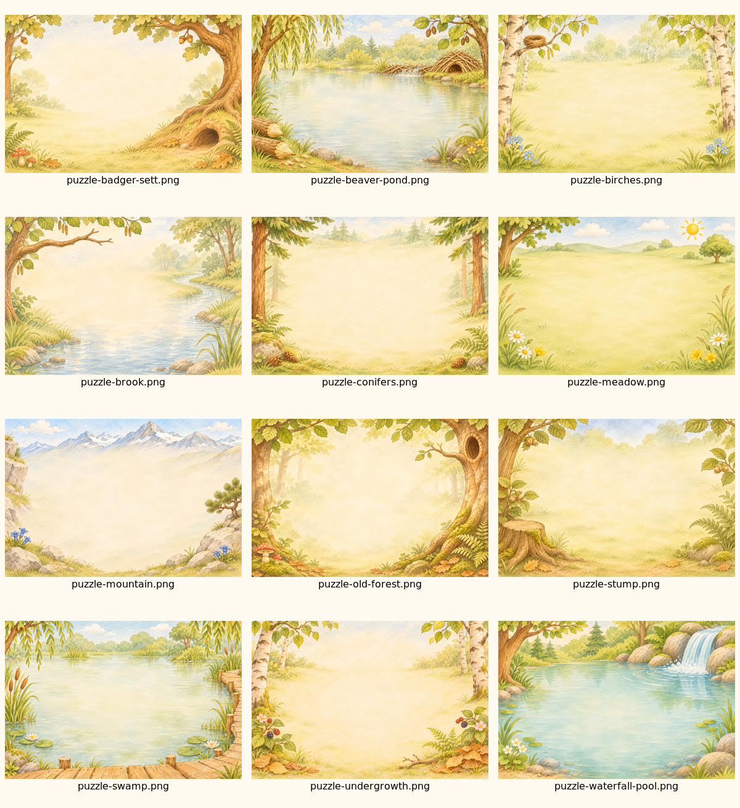
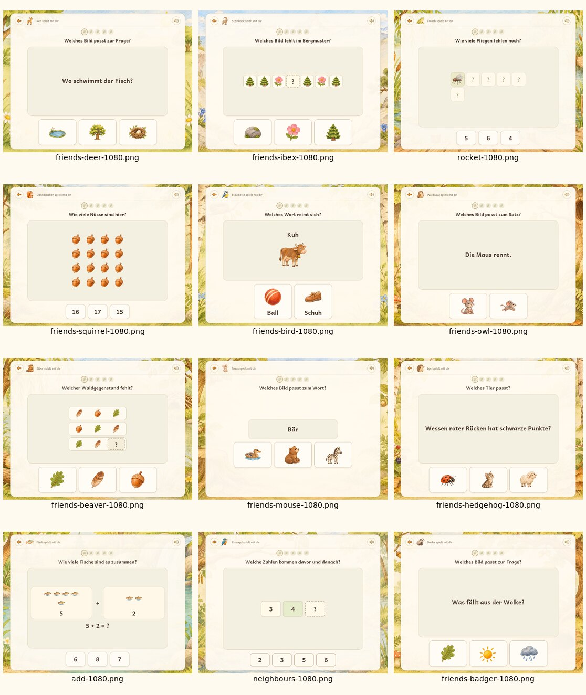
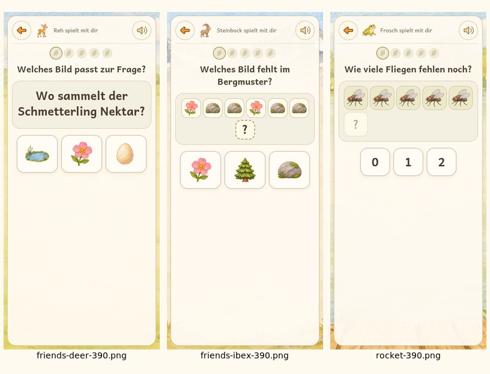

# Gastgeber und Lebensräume · Waldpost 9.4.25

Zwölf neue Aquarell-/Buntstiftlandschaften passen zum Wohnort des jeweiligen Tiers. Die Hintergründe erscheinen in allen 23 Rätseln mit 794 unveränderten Aufgaben: beim Spielen, in Galerierunden, in der Einzelprüfung und während der Feier. Reh bekommt eine Blumenwiese, Steinbock den Berg und Frosch den Sumpf mit Steg. Die übrigen Tiere erhalten passende Wald-, Bau- und Uferlandschaften.

`node tests/habitat-backgrounds-browser.cjs` prüft 139 Zustände mit den echten Rätselansichten: alle 23 Rätsel bei 1080 × 810, 390 × 844 und 844 × 390, dazu Einzelprüfung, Feier, Kinderrunde und ein gesperrtes Rätsel nach einem Gastgeberwechsel. Alle zwölf Dateien laden als 1536 × 1024, ohne Verzerrung oder horizontalen Überlauf. [Bericht](report.json)

Die Bilder wurden am 22. November 2026 mit `ChatGPT image_gen.imagegen` aus den vollständigen registrierten Anfragen und den beiden kanonischen Referenzbildern erzeugt. [Zuordnung, Quellen, Originalanfragen und Exportmanifeste](../../artwork/BACKGROUNDS.md)

Auf Wunsch des Eigentümers übernimmt 9.4.26 die bisherigen Freigaben über den reinen Hintergrundwechsel hinweg. Die Kompatibilität ist exakt an die Darstellungen vor und nach diesem Wechsel gebunden. Offene Aufgaben, spätere Ablehnungen und Kommentare bleiben wirksam; es wurden keine Freigaben erzeugt und keine Produktionsreviews geschrieben. Ein späterer Bildwechsel öffnet nur die Rätsel des betroffenen Tiers erneut.
