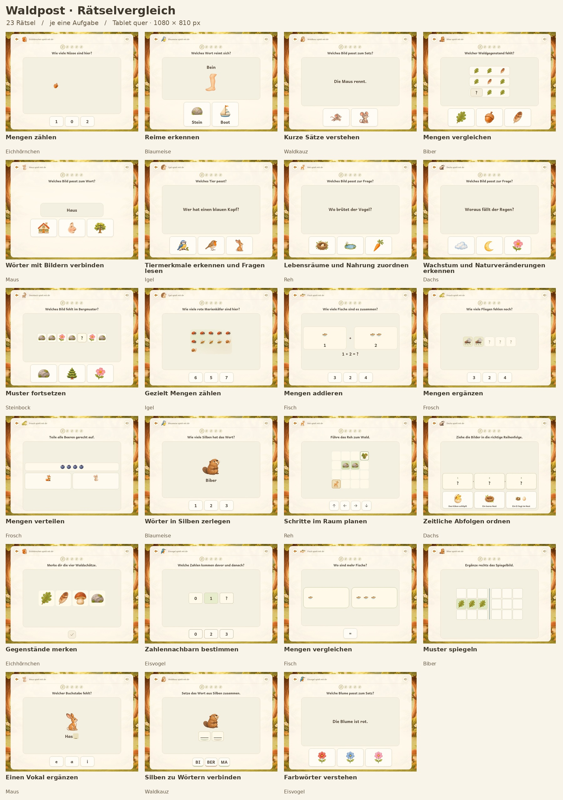
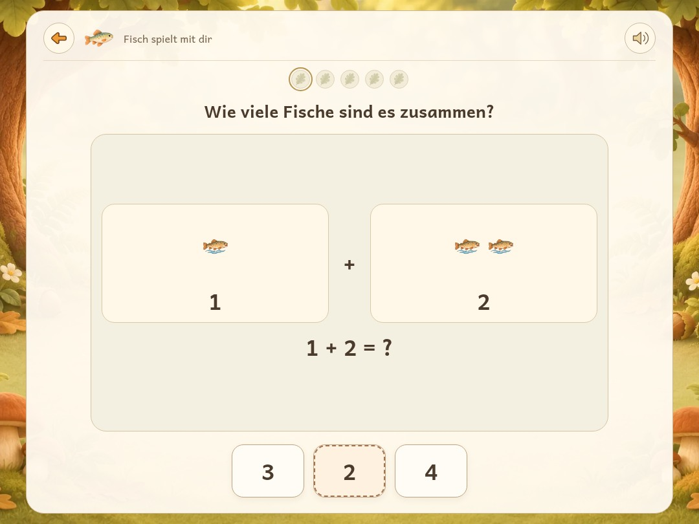
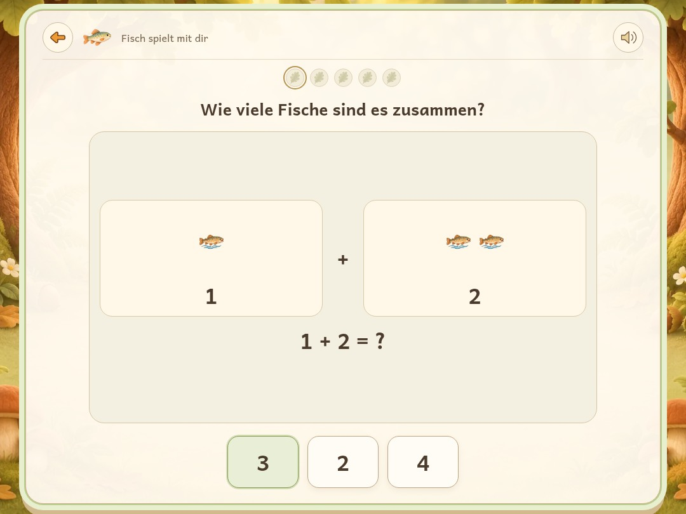

# Waldpost · Rätselvergleich

Alle 23 aktiven Rätsel in Katalogreihenfolge. Jede Aufnahme zeigt die zweite Katalogaufgabe als erste Aufgabe einer Galerierunde bei 1080 × 810 Pixeln. Die Verkleinerung ist für alle Seiten gleich. Über die Tabelle lässt sich jedes Original öffnen.

| Rätsel im Originalformat | Waldfreund | Aufgabe |
| --- | --- | --- |
| [Mengen zählen](friends-squirrel.jpg) | Eichhörnchen | `friends-squirrel/count-1` |
| [Reime erkennen](friends-bird.jpg) | Blaumeise | `friends-bird/rhyme-1` |
| [Kurze Sätze verstehen](friends-owl.jpg) | Waldkauz | `friends-owl/sentence-1` |
| [Mengen vergleichen](friends-beaver.jpg) | Biber | `friends-beaver/matrix-1` |
| [Wörter mit Bildern verbinden](friends-mouse.jpg) | Maus | `friends-mouse/word-1` |
| [Tiermerkmale erkennen und Fragen lesen](friends-hedgehog.jpg) | Igel | `friends-hedgehog/riddle-1` |
| [Lebensräume und Nahrung zuordnen](friends-deer.jpg) | Reh | `friends-deer/riddle-1` |
| [Wachstum und Naturveränderungen erkennen](friends-badger.jpg) | Dachs | `friends-badger/riddle-1` |
| [Muster fortsetzen](friends-ibex.jpg) | Steinbock | `friends-ibex/pattern-AAB-2` |
| [Gezielt Mengen zählen](count.jpg) | Igel | `count/6-3` |
| [Mengen addieren](add.jpg) | Fisch | `add/1-2` |
| [Mengen ergänzen](rocket.jpg) | Frosch | `rocket/5-2` |
| [Mengen verteilen](picnic.jpg) | Frosch | `picnic/2-2` |
| [Wörter in Silben zerlegen](syllable.jpg) | Blaumeise | `syllable/word-1` |
| [Schritte im Raum planen](robot.jpg) | Reh | `robot/0-1` |
| [Zeitliche Abfolgen ordnen](sequence.jpg) | Dachs | `sequence/story-1` |
| [Gegenstände merken](treasure.jpg) | Eichhörnchen | `treasure/0-1` |
| [Zahlennachbarn bestimmen](neighbours.jpg) | Eisvogel | `neighbours/1-left` |
| [Mengen vergleichen](compare.jpg) | Fisch | `compare/1-3` |
| [Muster spiegeln](mirror.jpg) | Biber | `mirror/grid-56` |
| [Einen Vokal ergänzen](vowels.jpg) | Maus | `vowels/word-0-3` |
| [Silben zu Wörtern verbinden](read-puzzle.jpg) | Waldkauz | `read-puzzle/word-1` |
| [Farbwörter verstehen](colour-words.jpg) | Eisvogel | `colour-words/rot-blau-rosa` |

## Antwortverhalten

Dieselbe Additionsaufgabe nach einer Eingabe, jeweils vor dem nächsten Schritt.

| Erneut versuchen | Richtig gelöst |
| --- | --- |
|  |  |

[Gestaltungsregeln für Rätselseiten](../../PUZZLE-BLUEPRINT.md)
